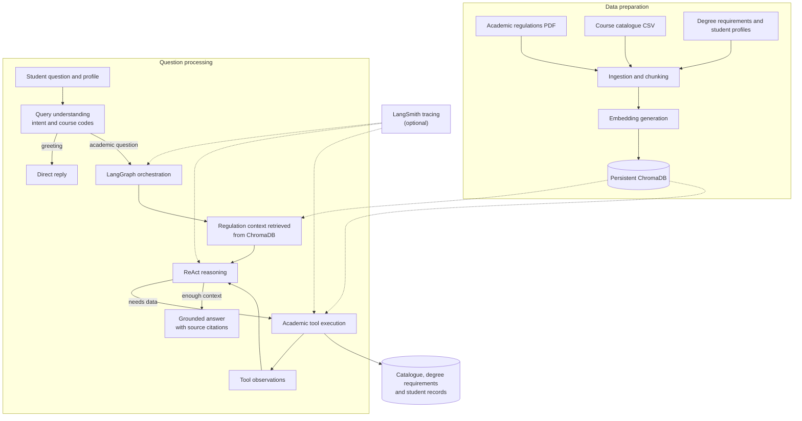

# AI Academic Advisor

A conversational advisor that answers course, prerequisite, degree-requirement and academic-policy questions from grounded university data.

Students usually have to piece together answers from regulations, course catalogues and their own academic record. This application puts one assistant in front of all of it: ask a question in plain language, and the answer is retrieved from university documents, checked against structured academic data and returned with citations. No answer is invented — every claim is traceable to a source that was actually read.

> **Demo data notice:** Northgate University and the accompanying regulations, courses, programmes and student profiles are fictional and exist only to demonstrate the system. This project is not affiliated with any real institution, and its answers are not official academic advice.

## Demo / Preview

The app is a Streamlit workspace with two tabs and a profile sidebar:

- **Advisor chat** — ask about prerequisites, schedules, degree progress or regulations. Answers appear in the conversation, with an expandable **Sources** panel showing the document name, PDF page and a short excerpt. A status line reports the detected intent, the academic tools that ran and whether the answer came from the LLM or the offline planner.
- **Course catalogue** — search the catalogue by topic, department and minimum level, with prerequisites, corequisites, schedule and descriptions shown per result.
- **Academic profile** — load a sample student or edit the programme, current semester, completed courses and interests. Every answer is tailored to this profile.

The sidebar also reports the active model, embedding backend, index status and LangSmith tracing state, with a button to rebuild the index.

## Problem Statement

Academic information is split across academic regulations and policy PDFs, course catalogues, degree requirements, prerequisite rules and individual student records. A question like "Can I take CS 410 next semester?" requires the course description, the prerequisite expression, the student's completed courses and the registration policy — four sources for one sentence.

Keyword search cannot connect those sources, and a general-purpose LLM chatbot is worse: it produces confident answers about policies and prerequisites it has never seen. Neither approach can verify that an answer applies to the student asking it.

## Solution

The AI Academic Advisor combines retrieval with real academic operations:

- A conversational interface that understands questions about courses, schedules, requirements and policy.
- Answers grounded in retrieved regulation text and structured catalogue records, not model memory.
- Student-aware reasoning — completed courses, programme and interests are part of every turn.
- Structured academic tools that check prerequisites, evaluate degree progress and look up schedules.
- Multi-step reasoning: the agent decides what information it still needs and calls tools until it has enough.
- Source-backed answers with document names and PDF page numbers.
- Graceful degradation: without an API key the same pipeline runs with a deterministic planner and extractive answers, clearly labelled as offline.

## Key Features

- **Context-aware academic assistance** — every answer is generated for the active student profile.
- **Hybrid retrieval** — semantic search across regulations and the catalogue, combined with lexical matching for precise course and policy terms.
- **RAG-based policy search** — regulation passages are chunked, embedded and retrieved with page-level provenance.
- **ReAct agent with academic tools** — the model selects from five real tools and observes their JSON results.
- **Prerequisite and eligibility checking** — parses `AND` / `OR` prerequisite expressions and names the missing courses.
- **Degree requirement tracking** — compares completed courses with programme requirements and reports what remains.
- **Source citations** — answers cite document labels such as `academic_regulations.pdf, p. 3`, with a verified source list appended.
- **Persistent index and optional observability** — ChromaDB survives restarts and skips re-embedding unchanged data; LangSmith tracing can record every graph, tool and model call.

## System Architecture



Dashed edges are optional tracing or vector lookups made by tools. The ReAct loop is bounded, so a turn can run at most three tool rounds before answering.

## How It Works

1. **Ingestion** — the regulations PDF, course catalogue CSV and degree/student JSON files are loaded and normalised.
2. **Indexing** — regulation pages are chunked with page metadata, courses are enriched with searchable text, and both are embedded into a persistent ChromaDB index. A manifest signature skips rebuilding when nothing relevant changed.
3. **Query understanding** — the question is classified (course search, prerequisites, eligibility, degree requirements, schedule, recommendation or policy) and course codes are extracted.
4. **Retrieval and reasoning** — relevant regulation passages are retrieved, then the LangGraph agent reasons about the question and chooses the academic tools it needs.
5. **Tool execution** — the agent runs prerequisite checks, degree audits, course searches, schedule lookups or document searches, and feeds the observations back into its reasoning.
6. **Grounded response** — the final answer is generated strictly from retrieved context and tool results, then the verified source list is appended.

Without an API key, steps 4–6 switch to a deterministic planner that selects the same tools from the classified intent and composes an extractive answer from the observations. The interface labels this mode, and no model is called or simulated.

## Technology Stack

| Purpose | Technology |
| --- | --- |
| Interface | Streamlit |
| Language | Python 3.11+ |
| Agent orchestration | LangGraph (state graph, conditional routing, in-process memory) |
| Retrieval | RAG with hybrid semantic and lexical ranking, ChromaDB |
| Embeddings | Gemini, OpenAI or a local hashing embedder |
| LLM providers | Gemini (default), Groq, OpenAI-compatible endpoints |
| Observability | LangSmith tracing (optional) |
| Data processing | Pandas, PyMuPDF, LangChain text splitters |
| Configuration | python-dotenv |

## Getting Started

Requirements: Python 3.11 or newer and Git.

```powershell
# Windows PowerShell
git clone https://github.com/Sainath-10/AI-Academic-Advisor.git
cd AI-Academic-Advisor
py -3.11 -m venv .venv
.venv\Scripts\Activate.ps1
python -m pip install -r requirements.txt
```

```bash
# Linux / macOS
git clone https://github.com/Sainath-10/AI-Academic-Advisor.git
cd AI-Academic-Advisor
python3 -m venv .venv
source .venv/bin/activate
python -m pip install -r requirements.txt
```

## Configuration

Copy the example file and add a provider key:

```bash
cp .env.example .env
```

```dotenv
# Default: Google Gemini
GEMINI_API_KEY=your-gemini-key
LLM_PROVIDER=gemini
EMBEDDING_PROVIDER=auto
```

| Variable | Purpose |
| --- | --- |
| `LLM_PROVIDER` | `gemini` (default), `groq`, `openai` or `openai-compatible` |
| `GEMINI_API_KEY`, `GROQ_API_KEY`, `OPENAI_API_KEY` | Provider credentials, matched to the selected provider |
| `EMBEDDING_PROVIDER` | `auto`, `gemini`, `openai` or `local` |
| `LANGSMITH_API_KEY`, `LANGSMITH_PROJECT` | Enable and name LangSmith tracing |

Use Groq for free, fast chat completions by setting `LLM_PROVIDER=groq` and `GROQ_API_KEY`. Groq serves no embeddings, so `EMBEDDING_PROVIDER=auto` pairs it with Gemini embeddings when a Gemini key is present, and with the local embedder otherwise. Set `EMBEDDING_PROVIDER=local` to run entirely without embedding API calls. Tracing switches on automatically when `LANGSMITH_API_KEY` is set.

## Running the Application

1. Create `.env` as described above (optional — the app still runs offline).
2. Build the index if you want to do it ahead of time. The first launch builds it automatically; force a rebuild with:

   ```powershell
   .venv\Scripts\python.exe -c "import sys; sys.path.insert(0, 'src'); from ingestion import build_index; print(build_index(force=True))"
   ```

   ```bash
   .venv/bin/python -c "import sys; sys.path.insert(0, 'src'); from ingestion import build_index; print(build_index(force=True))"
   ```

3. Start the app from the repository root:

   ```powershell
   .venv\Scripts\python.exe -m streamlit run src/app.py
   ```

   ```bash
   .venv/bin/python -m streamlit run src/app.py
   ```

Open `http://localhost:8501`. Use **Advisor chat** for questions and **Course catalogue** for browsing; the sidebar can rebuild the index after data changes.

## Example Queries

| Query | What the advisor does |
| --- | --- |
| What are the prerequisites for Machine Learning? | Finds the course, evaluates its prerequisite expression and cites the catalog entry |
| Can I take CS 410 next semester? | Checks completed courses against the prerequisites and names what is missing |
| Have I completed all my degree requirements? | Audits the student's record against programme requirements and lists remaining categories |
| What is the maximum credit load per semester? | Retrieves the relevant regulation passage and cites the page |
| Which courses should I take next semester? | Combines course search, interests and remaining degree requirements into recommendations |

## Limitations

- The university, catalogue and regulations are fictional sample data, not real academic policy.
- The catalogue is deliberately small (35 courses, 10 regulation pages), so retrieval quality on a full university dataset is untested.
- The local hashing embedder is lexical feature hashing, not a neural embedding model; it is a fallback, not a substitute for Gemini or OpenAI embeddings.
- Free-tier API quotas vary by provider and model, and a rate-limited model call falls back to an offline answer.
- Offline mode produces extractive, template-based answers — useful and grounded, but less fluent than LLM output.
- Profile edits in the sidebar last only for the browser session and are not written back to the student files.
- There is no authentication, user accounts or shared database; it is a single-user local application.
- Conversation memory is an in-process LangGraph checkpointer, so history is lost when the process restarts.
